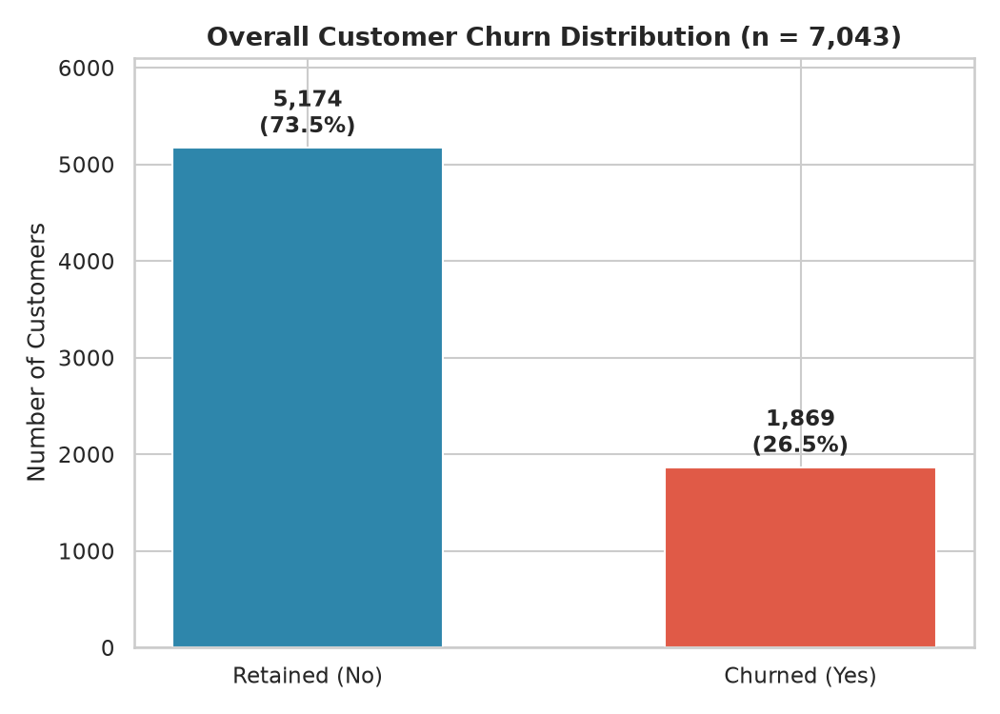
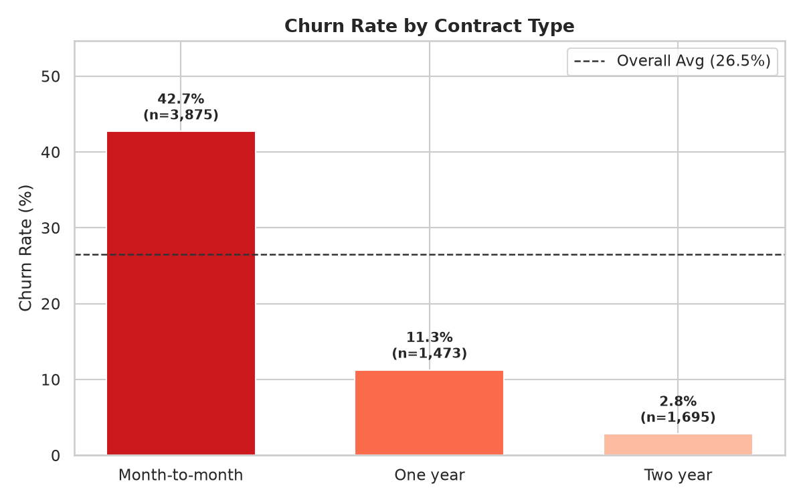
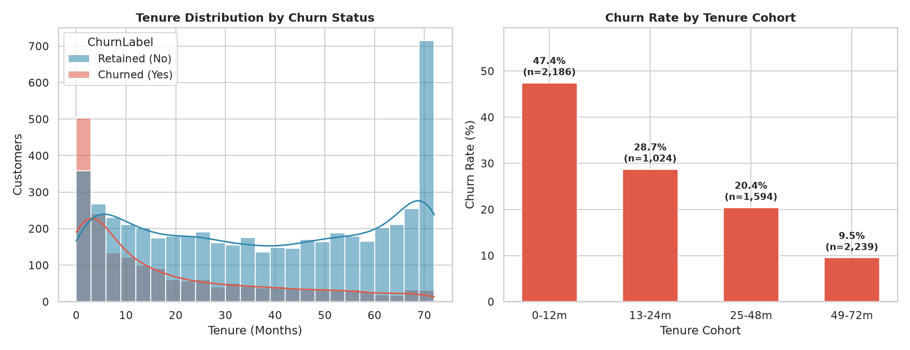
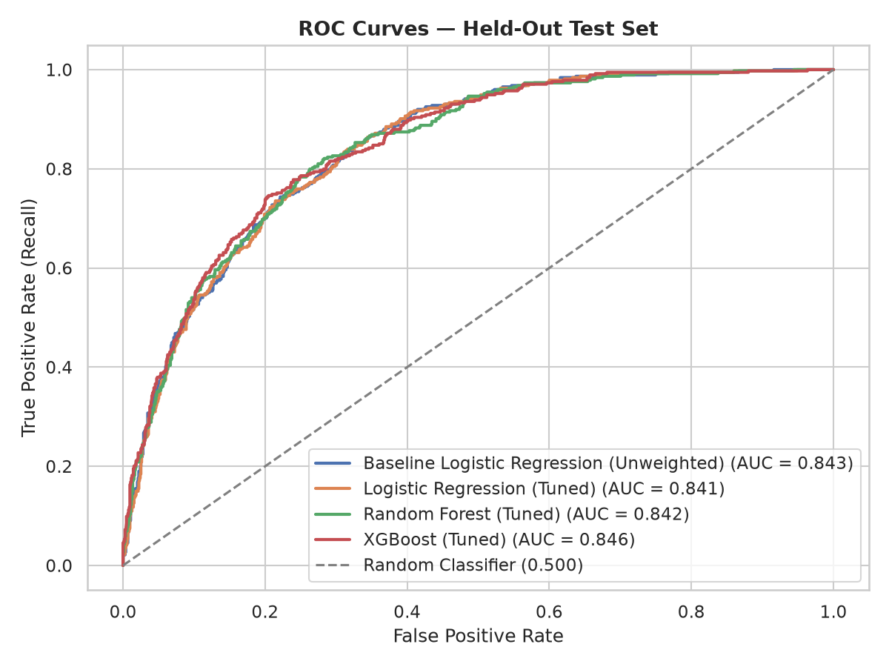
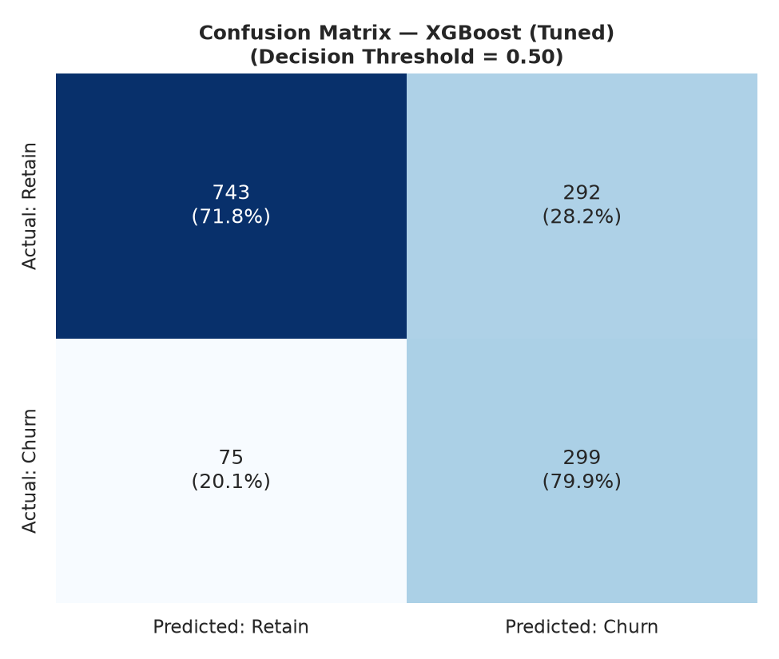
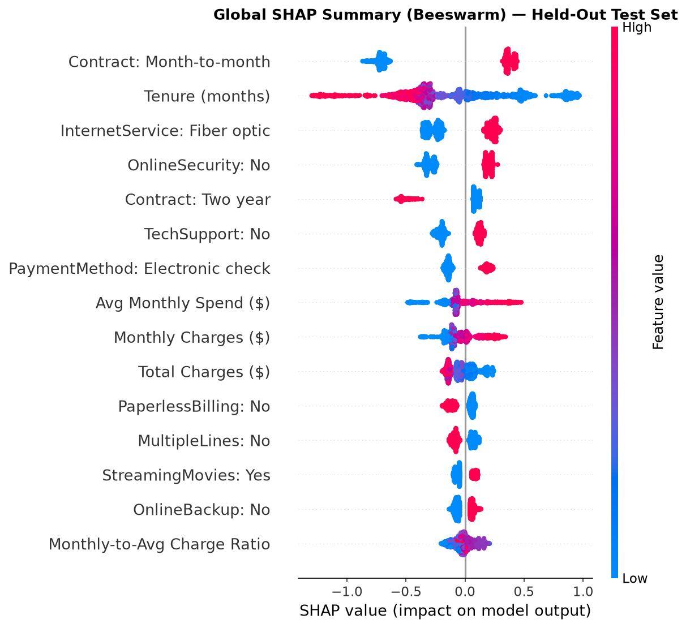
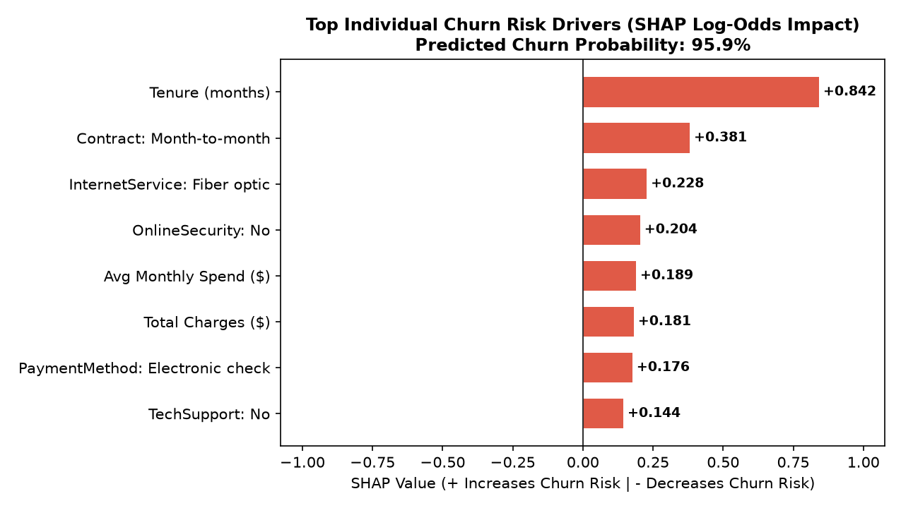

# 📡 End-to-End Customer Churn Prediction System

A production-style Machine Learning, Explainability (SHAP), REST API (FastAPI), and Interactive Dashboard (Streamlit + Modular RAG) system built on the **IBM Telco Customer Churn** dataset.

Designed to demonstrate clean ML engineering architecture: leakage-free preprocessing pipelines, stratified cross-validation, class-imbalance handling, model artifact versioning, customer-level SHAP explanations, automated testing, Docker packaging, and transparent technical reporting.

---

## 1. Project Overview & Business Problem

Customer acquisition in telecommunications is expensive, making early identification of customers likely to cancel ("churn") critical for targeted retention. Rather than issuing costly blanket discounts to all subscribers, retention teams need:
1. **Accurate churn risk ranking** across imbalanced historical data (**26.54%** observed churn rate).
2. **Configurable operational risk tiers** (`Low`, `Medium`, `High`) aligned to retention budgets.
3. **Transparent customer-level explanations** answering *"Why did this customer receive a high churn-risk prediction?"*
4. **Reusable inference infrastructure** accessible via both a REST API (`FastAPI`) and a business-facing dashboard (`Streamlit`).

---

## 2. Dataset Description & Source

- **Dataset**: IBM Telco Customer Churn (`WA_Fn-UseC_-Telco-Customer-Churn.csv`), widely available on Kaggle.
- **Records**: **7,043** unique customers across **21** columns (19 raw predictor features, `customerID`, and binary `Churn` target).
- **Feature Groups**:
  - **Demographics**: `gender`, `SeniorCitizen`, `Partner`, `Dependents`
  - **Account & Billing**: `tenure`, `Contract`, `PaperlessBilling`, `PaymentMethod`, `MonthlyCharges`, `TotalCharges`
  - **Subscribed Services**: `PhoneService`, `MultipleLines`, `InternetService`, `OnlineSecurity`, `OnlineBackup`, `DeviceProtection`, `TechSupport`, `StreamingTV`, `StreamingMovies`

---

## 3. Technology Stack

| Layer | Technologies |
|---|---|
| **Data & EDA** | Python 3.13, Pandas, NumPy, Matplotlib, Seaborn, Plotly, Jupyter |
| **Machine Learning** | Scikit-learn (`Pipeline`, `ColumnTransformer`, `RandomizedSearchCV`), XGBoost, Imbalanced-learn (SMOTE), Joblib |
| **Explainability** | SHAP (`TreeExplainer` / `LinearExplainer`), global & customer-level attribution |
| **API Backend** | FastAPI, Uvicorn, Pydantic v2, OpenAPI/Swagger |
| **Frontend Dashboard** | Streamlit (multi-page interactive dashboard + Plotly gauges/charts) |
| **Optional GenAI / RAG** | Local TF-IDF grounded retrieval (zero API key required) + modular LangChain / ChromaDB / Groq / OpenAI support |
| **Testing & Packaging** | Pytest, FastAPI `TestClient`, Streamlit `AppTest`, Docker, Docker Compose |

---

## 4. System Architecture

Full Mermaid architecture and sequence diagrams are documented in [reports/evaluation/architecture_diagram.md](reports/evaluation/architecture_diagram.md).

```text
customer-churn-prediction/
├── data/
│   ├── raw/                     # Raw IBM Telco CSV (gitignored)
│   └── processed/               # Cleaned CSV (gitignored)
├── notebooks/
│   ├── 01_data_exploration.ipynb
│   ├── 02_feature_engineering.ipynb
│   ├── 03_model_training.ipynb
│   └── 04_model_explainability.ipynb
├── src/
│   ├── config.py                # Paths, schema, configurable risk thresholds
│   ├── data_processing.py       # Cleaning, quality checks, EDA summary & figures
│   ├── feature_engineering.py   # Stateless TelcoFeatureEngineer + ColumnTransformer
│   ├── train.py                 # CV benchmarks, SMOTE/weighting, tuning, artifact export
│   ├── evaluate.py              # Classification metrics, ROC/PR/CM/threshold plots
│   ├── explain.py               # Global & local SHAP explainability
│   ├── predict.py               # Decoupled inference facade (ChurnPredictor)
│   └── rag/
│       ├── assistant.py         # Grounded local RAG + optional Groq/OpenAI LLM mode
│       └── vector_store.py      # Optional ChromaDB chunk indexer
├── models/
│   ├── churn_pipeline_v1.0.0.joblib
│   ├── churn_pipeline_latest.joblib
│   ├── model_metadata.json
│   └── shap_background.csv
├── api/
│   ├── schemas.py               # Pydantic v2 contracts
│   └── main.py                  # FastAPI endpoints (/health, /model-info, /predict, /predict/explain, /predict/batch)
├── app/
│   ├── streamlit_app.py         # Executive overview entrypoint
│   └── pages/
│       ├── 1_Overview_Dashboard.py
│       ├── 2_Customer_Prediction.py
│       ├── 3_Model_Performance.py
│       └── 4_AI_Assistant.py
├── reports/
│   ├── figures/                 # 17 generated EDA, evaluation, and SHAP PNGs
│   └── evaluation/              # JSON/CSV metrics, architecture diagram, technical report
├── tests/                       # 22 automated unit, pipeline, API, RAG, and Streamlit tests
├── Dockerfile
├── docker-compose.yml
├── requirements.txt
└── requirements-rag.txt
```

---

## 5. Data Preprocessing Methodology

1. **Deterministic Cleaning (`src/data_processing.py`)**:
   - Verified **0 duplicate rows** and **0 duplicate `customerID`s**.
   - Identified **11 blank whitespace strings** in `TotalCharges` — all 11 correspond to `tenure == 0` customers (0 months billed) and are deterministically set to `0.0`.
   - Mapped `Churn` (`Yes -> 1`, `No -> 0`) and validated numeric bounds (0 IQR outliers in numeric columns).
2. **Leakage-Free Feature Engineering (`src/feature_engineering.py`)**:
   - Stratified **80/20 train/test split** (`5,634` train / `1,409` test, exact `26.54%` churn rate in both splits) performed **before** any fitting.
   - Row-wise engineered features: `avg_monthly_spend`, `charge_ratio`, `service_count`, `has_support_bundle`, `is_auto_pay`, and `tenure_group`.
   - `ColumnTransformer` handles median/mode imputation, scaling (for linear models), and `OneHotEncoder(handle_unknown="ignore", sparse_output=False)` across **54 transformed features**.
   - When SMOTE is tested, it runs strictly inside training folds via `imblearn.pipeline.Pipeline`.

---

## 6. Key EDA Findings (Measured)

- **Overall Churn Rate**: **26.54%** (`1,869` churned vs. `5,174` retained; `2.77:1` imbalance).
- **Contract Type**: Month-to-month customers churn at **42.7%** (`1,655 / 3,875`) vs. **11.3%** (One year) and **2.8%** (Two year).
- **Tenure**: First-year customers (`0–12 months`) churn at **47.4%**, dropping steadily to **9.5%** for `49–72 months`.
- **Payment Method**: Electronic check payers churn at **45.3%**, nearly **3x** higher than automatic credit card (**15.2%**) or bank transfer (**16.7%**).
- **Internet & Support Services**: Fiber optic subscribers churn at **41.9%** (vs. **19.0%** DSL); customers lacking `OnlineSecurity` (**41.8%**) or `TechSupport` (**41.6%**) churn far more than subscribers with those add-ons (~**15%**).
- **Measured Monthly Billing Exposure**: Churned accounts average **$74.44/month** (vs. **$61.27/month** retained) and represent **$139,130.85** (**30.5%**) of the **$456,116.60** total monthly charges in the dataset.





---

## 7. Model Comparison & Final Evaluation Results

Models were selected strictly on **5-fold stratified CV** using a business-aligned composite (`0.45 * CV_ROC_AUC + 0.30 * CV_PR_AUC + 0.25 * CV_F1`) — never raw accuracy alone.

| Model | Stage | CV ROC-AUC | CV PR-AUC | CV F1 | Test ROC-AUC | Test PR-AUC | Test F1 | Test Recall | Test Precision | Test Accuracy |
|---|---|---:|---:|---:|---:|---:|---:|---:|---:|---:|
| **XGBoost (Tuned)** *(Selected)* | tuned | **0.8500** | **0.6677** | 0.6323 | **0.8464** | **0.6648** | 0.6197 | **0.7995** | 0.5059 | 0.7395 |
| Random Forest (Tuned) | tuned | 0.8477 | 0.6646 | 0.6297 | 0.8424 | 0.6503 | 0.6290 | 0.7888 | 0.5230 | 0.7530 |
| XGBoost (Weighted) | comparison | 0.8471 | 0.6618 | 0.6340 | 0.8460 | 0.6569 | 0.6378 | 0.7888 | 0.5354 | 0.7622 |
| Random Forest (Balanced) | comparison | 0.8462 | 0.6622 | 0.6337 | 0.8420 | 0.6559 | 0.6276 | 0.7727 | 0.5283 | 0.7566 |
| Logistic Regression (Tuned) | tuned | 0.8458 | 0.6617 | 0.6290 | 0.8414 | 0.6323 | 0.6123 | 0.7834 | 0.5026 | 0.7367 |
| Baseline Logistic Regression (Unweighted) | comparison | 0.8458 | 0.6630 | 0.5957 | 0.8426 | 0.6378 | 0.5804 | 0.5214 | 0.6544 | 0.7999 |
| Logistic Regression (Balanced) | comparison | 0.8456 | 0.6620 | 0.6251 | 0.8422 | 0.6363 | 0.6146 | 0.7888 | 0.5034 | 0.7374 |
| XGBoost (SMOTE) | comparison | 0.8448 | 0.6547 | 0.6039 | 0.8471 | 0.6644 | 0.6006 | 0.5749 | 0.6287 | 0.7970 |
| Logistic Regression (SMOTE) | comparison | 0.8439 | 0.6600 | 0.6306 | 0.8406 | 0.6336 | 0.6175 | 0.7941 | 0.5051 | 0.7388 |
| Random Forest (SMOTE) | comparison | 0.8423 | 0.6420 | 0.6127 | 0.8365 | 0.6361 | 0.5987 | 0.6123 | 0.5857 | 0.7821 |

### Final Selected Model (`XGBoost (Tuned)`, `v1.0.0`)
- **Confusion Matrix (Test Set, n = 1,409, threshold = 0.50)**: `TP = 299`, `FN = 75`, `FP = 292`, `TN = 743`
- **Business Trade-Off**: Captures **79.95%** of churning customers (cutting missed churners from 179 under the unweighted baseline down to 75) while giving retention teams an interactive probability threshold to control outreach cost.




---

## 8. SHAP Explainability

Global and individual customer explanations are generated directly from the trained `XGBClassifier` via `shap.TreeExplainer`:

| Rank | Feature | Mean \|SHAP\| (Test Set) |
|---:|---|---:|
| 1 | Contract: Month-to-month | 0.5297 |
| 2 | Tenure (months) | 0.4239 |
| 3 | InternetService: Fiber optic | 0.2541 |
| 4 | OnlineSecurity: No | 0.2505 |
| 5 | Contract: Two year | 0.1938 |
| 6 | TechSupport: No | 0.1648 |
| 7 | PaymentMethod: Electronic check | 0.1614 |




> **Note**: SHAP quantifies each feature's statistical contribution to the model's log-odds output; feature importance does not imply proven causation.

---

## 9. API Documentation (FastAPI)

Start the API locally:
```bash
uvicorn api.main:app --reload --port 8000
```
Interactive OpenAPI / Swagger UI is available at `http://localhost:8000/docs`.

| Method | Endpoint | Description |
|---|---|---|
| `GET` | `/health` | Service readiness & loaded model version |
| `GET` | `/model-info` | Active model metadata, feature schema, and test metrics |
| `POST` | `/predict` | Single customer churn prediction, probability, and configurable risk tier |
| `POST` | `/predict/explain` | Prediction + customer-level SHAP drivers & retention considerations |
| `POST` | `/predict/batch` | Batch scoring for up to 500 validated customer records |

Example request:
```bash
curl -X POST "http://localhost:8000/predict/explain?low_threshold=0.30&high_threshold=0.65" \
  -H "Content-Type: application/json" \
  -d '{
    "gender": "Female", "SeniorCitizen": 0, "Partner": "No", "Dependents": "No",
    "tenure": 3, "PhoneService": "Yes", "MultipleLines": "No",
    "InternetService": "Fiber optic", "OnlineSecurity": "No", "OnlineBackup": "No",
    "DeviceProtection": "No", "TechSupport": "No", "StreamingTV": "Yes",
    "StreamingMovies": "Yes", "Contract": "Month-to-month", "PaperlessBilling": "Yes",
    "PaymentMethod": "Electronic check", "MonthlyCharges": 94.5, "TotalCharges": 283.5
  }'
```

---

## 10. Installation & Reproducible Execution

```bash
# 1. Create and activate virtual environment
python3 -m venv .venv
source .venv/bin/activate

# 2. Install core dependencies
pip install -r requirements.txt

# 3. Reproduce full data, training, evaluation, and SHAP pipelines
python -m src.data_processing
python -m src.train
python -m src.explain

# 4. Run automated test suite
pytest -v

# 5. Launch Streamlit dashboard
streamlit run app/streamlit_app.py

# 6. Launch FastAPI backend (in another terminal)
uvicorn api.main:app --host 0.0.0.0 --port 8000
```

### Optional LLM + ChromaDB RAG Configuration
The AI Assistant page works **out-of-the-box with zero API keys** via local grounded TF-IDF retrieval over project artifacts. To enable full LLM synthesis:
```bash
pip install -r requirements-rag.txt
cp .env.example .env
# Add GROQ_API_KEY or OPENAI_API_KEY to .env (never commit .env!)
python -m src.rag.vector_store
```

---

## 11. Deployment Guide

> **Live Deployment Status**: Ready for push-button deployment once connected to your GitHub account (no fabricated live links are included here).

### Option A — Streamlit Community Cloud (Dashboard)
1. Push this repository to GitHub (`customer-churn-prediction`).
2. Visit [share.streamlit.io](https://share.streamlit.io) → **New app**.
3. Select your repository, branch `main`, and entrypoint `app/streamlit_app.py`.
4. (Optional) Add `GROQ_API_KEY` or `OPENAI_API_KEY` in Streamlit Secrets if you want LLM synthesis.
5. Note: `models/churn_pipeline_latest.joblib` (299 KB) and `reports/` are lightweight and self-contained; for the Overview Dashboard on Streamlit Cloud without committing raw CSVs, include a small public sample or point `PROCESSED_DATA_PATH` appropriately.

### Option B — FastAPI Backend via Docker / Hugging Face Spaces
```bash
docker build -t customer-churn-api .
docker run -p 7860:7860 customer-churn-api
# Verify: curl http://localhost:7860/health
```
The `Dockerfile` defaults to port `7860`, matching **Hugging Face Spaces (Docker SDK)** out-of-the-box.

---

## 12. Limitations & Future Improvements

- **Static Snapshot**: The dataset lacks temporal usage trends, support call logs, or outage history.
- **Probability Calibration**: `scale_pos_weight` improves recall/ranking but shifts predicted probabilities upward; add `CalibratedClassifierCV` before plugging probabilities into expected-dollar ROI formulas.
- **Causal Uplift**: High predicted churn risk does not guarantee a customer is persuadable by an incentive; combine with A/B holdout testing and uplift modeling.
- **Data Drift Monitoring**: Add automated PSI/KS drift checks and scheduled retraining pipelines for live production operation.

See [reports/evaluation/technical_report.md](reports/evaluation/technical_report.md) for the complete technical analysis and CV-ready project description.
